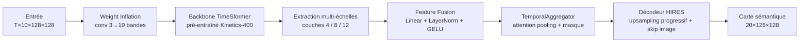
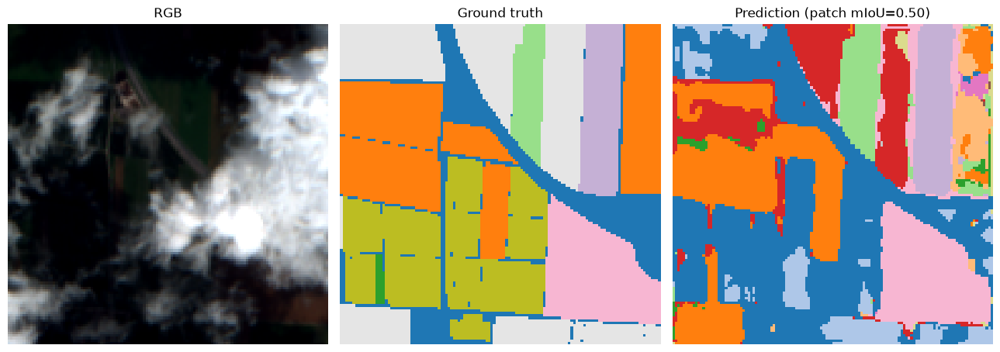
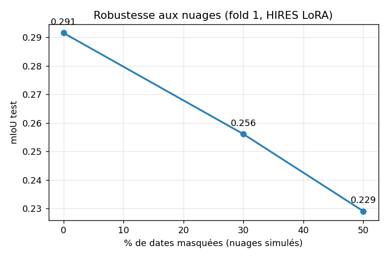

<!--
  Pour illustrer le rapport, dépose tes figures dans un dossier docs/ :
    docs/qualitative.png   -> triptyques RGB | vérité terrain | prédiction (notebook qualitative_maps)
    docs/attention.png     -> poids d'attention temporelle par date (masque = 0)
    docs/ablation.png      -> (optionnel) barres décodeur simple vs HIRES
  puis vérifie que les chemins  ci-dessous pointent bien dessus.
  Remplace les [À COMPLÉTER] par tes chiffres 5-fold quand ils sont prêts.
-->

# 🛰️ Classification de séries temporelles d'images satellites — Méthode 1 : TimeSformer

> **Mini-rapport de projet — Master 2.** Segmentation sémantique de séries temporelles
> Sentinel-2 (dataset **PASTIS**) par transfert d'un *Video Transformer* (**TimeSformer**)
> pré-entraîné sur la vidéo naturelle (Kinetics-400). Baseline de référence : **U-TAE (mIoU 0.631)**.
>
> *La Méthode 2 (V-JEPA) est documentée séparément par mon binôme. Ce dépôt présente ma contribution : la Méthode 1.*

---

## 1. Problématique

Classer **chaque pixel** d'une parcelle agricole (18 cultures + fond) à partir d'une **série
temporelle** d'images satellites multispectrales. La difficulté : exploiter à la fois la
**dynamique temporelle** (phénologie des cultures), l'**information spectrale** (10 bandes) et
la **structure spatiale** (frontières de parcelles), sur des séries de **longueur variable** et
partiellement **nuageuses**.

**Hypothèse de recherche.** Un transformer vidéo générique (TimeSformer) peut-il être transféré
à l'imagerie satellite dense, et **où se situe le goulot d'étranglement** par rapport à une
architecture spécialisée comme U-TAE ?

---

## 2. Données — PASTIS

| Caractéristique | Valeur |
|---|---|
| Patchs | ~2 433 (128×128 px, résolution 10 m) |
| Bandes spectrales | 10 (Sentinel-2) |
| Longueur temporelle | variable, ~33–61 acquisitions |
| Classes | 18 cultures + *Background* (0) + *Void* (19) |
| Découpage | **5 folds géographiques** (évite la fuite spatiale) |
| Vérité terrain | parcelles annotées ; *void* = pixels ambigus / bords |

La classe **void (19) est ignorée** à l'entraînement et à l'évaluation (pixels non labellisés) ;
le **background (0) est scoré** → **protocole identique à U-TAE** (19 classes scorées).

---

## 3. Méthode

### 3.1 Architecture



### 3.2 Adaptation de domaine — *Weight Inflation*
La 1ʳᵉ convolution (3 canaux RGB) est étendue à **10 canaux multispectraux** par duplication
des poids et pondération `×3/10`, ce qui **conserve la variance** du signal d'origine.

### 3.3 Pyramide de caractéristiques (choix de conception)
Extraction de 3 niveaux du transformer — **couche 4** (texture/spectre), **couche 8**
(géométrie/frontières), **couche 12** (sémantique) — fusionnés pour réinjecter un **biais
inductif spatial multi-échelle**.

### 3.4 Agrégation temporelle & masquage
- **Rejet du mean-pooling** (qui détruit la chronologie phénologique).
- **`TemporalAggregator`** : *attention pooling* avec **query apprenable** → le réseau apprend
  une pondération temporelle non-uniforme et **adaptative par patch**.
- **Masquage** : le `padding_mask` est passé en `key_padding_mask` → le softmax force
  l'attention des dates de padding (et nuages simulés) à **exactement 0** *(vérifié, cf. §5.5)*.

### 3.5 Décodeur — le levier clé
- **Baseline** : un seul `Upsample ×16` depuis la grille de tokens **8×8** → segmentation
  décidée à 8×8 (frontières impossibles).
- **HIRES** (correction) : **upsampling progressif appris** (8→16→32→64→128) + **skip
  haute-résolution depuis l'image brute** (réinjecte le détail spatial, cf. SETR-PUP / DPT).

### 3.6 Stratégies de transfert (pilotées par YAML)
**Full Fine-Tuning · Linear Probing · LoRA** (r=8). Découverte de débogage importante :
> `peft` gelait **tout** le backbone, y compris les couches d'entrée chirurgicalement
> modifiées — projection 10 bandes, **position-embeddings réinitialisés** (224→128 px),
> time-embeddings interpolés (8→60 frames). Gelées, elles ne pouvaient pas apprendre le
> domaine satellite. **Correction : on les dégèle explicitement** après `get_peft_model`.

---

## 4. Protocole expérimental

- **Validation croisée 5 folds** : test = 1 fold, validation = fold adjacent, entraînement =
  3 folds restants (≈ **1450 / 496 / 487** patchs).
- **Sélection** : meilleur checkpoint sur la **validation**, évalué **une seule fois** sur le
  fold de **test** tenu à l'écart.
- **Pertes** : `dice_ce` (CE par pixel + Dice optimisant l'IoU) ; **pondération de classes**
  *median-frequency* (cap 3) pour éviter l'effondrement vers le background.
- **Métriques** : **mIoU** (principale), **Macro-F1**, **Overall Accuracy** — mIoU calculé en
  **excluant les classes absentes** d'un fold (pas de biais à la baisse).
- **Reproductibilité** : seed fixe, `cudnn.deterministic`.

---

## 5. Résultats

### 5.1 Ablation du décodeur — résultat principal (fold 1, test)

| Décodeur | mIoU | Overall Acc | Macro-F1 |
|---|---|---|---|
| Simple (`Upsample ×16`) | 0.095 | 0.323 | 0.162 |
| **HIRES (progressif + skip)** | **0.291** | **0.638** | **0.418** |
| | **×3.1** | ×2.0 | ×2.6 |

➡️ **Le goulot d'étranglement était la résolution du décodeur, pas le backbone temporel.**

### 5.2 Scores par classe (HIRES, fold 1)
Grandes cultures bien segmentées — **Corn 0.59 · Rapeseed 0.59 · Background 0.57 ·
Meadow 0.55 · Beet 0.51 · Soft winter wheat 0.49**. Traîne des classes rares faible —
*Spring barley 0.04 · Sorghum 0.06 · Mixed cereal 0.09* (déséquilibre de classes).

### 5.3 Validation croisée 5 folds (champion HIRES + LoRA)

| | mIoU | Overall Acc | Macro-F1 |
|---|---|---|---|
| **HIRES + LoRA (5-fold)** | **0.285 ± 0.009** | 0.620 | 0.409 ± 0.011 |
| *Référence U-TAE* | *0.631* | — | — |

Détail par fold : 0.291 / 0.289 / 0.291 / 0.285 / 0.269 (folds 1→5). **σ = 0.009 sur des
folds géographiques distincts → résultat stable et robuste**, pas un artefact d'un fold particulier.

### 5.4 Ablation de stratégie de transfert (à fold égal, décodeur HIRES)

| Stratégie | Fold | mIoU | Macro-F1 |
|---|---|---|---|
| **LoRA** | 1 | **0.291** | 0.418 |
| Full Fine-Tuning | 1 | 0.269 | 0.390 |
| **LoRA** | 3 | **0.291** | 0.416 |
| Linear Probing | 3 | 0.279 | 0.401 |

À fold égal : **LoRA > Linear Probing > Full Fine-Tuning**. Le full fine-tuning sous-performe
(sur-apprentissage sur ~1465 patchs). Surtout, les trois stratégies restent dans un intervalle
étroit (~0.27–0.29) : **la stratégie de transfert n'est pas le goulot d'étranglement — le
décodeur l'était (×3, §5.1).** C'est le résultat central de cette étude.

### 5.5 Résultats qualitatifs


Les grandes parcelles sont récupérées avec des **frontières nettes** (le décodeur HIRES
supprime les artefacts en blocs 16×16 de la baseline) ; les parcelles fines/rares restent
bruitées — manifestation directe de la résolution sémantique 8×8.

### 5.6 Analyse de l'attention temporelle


Deux résultats **vérifiés empiriquement** : (1) les dates masquées reçoivent une attention
**strictement nulle** (validation du mécanisme de masquage) ; (2) au sein d'une série,
l'attention est fortement **non-uniforme** (~5×). Moyennée sur les patchs, elle ne montre
**aucune préférence saisonnière fixe** → la pondération est **adaptative par patch** (sélection
des dates informatives propres à chaque série), et non une fenêtre calendaire.

### 5.7 Robustesse aux nuages


En masquant aléatoirement une fraction des dates (nuages simulés, fold 1) :

| % dates masquées | 0 % | 30 % | 50 % |
|---|---|---|---|
| mIoU | 0.291 | 0.256 | 0.229 |
| Δ vs 0 % | — | −12 % | −21 % |

**Dégradation gracieuse** : à 50 % de dates masquées, le modèle conserve **79 %** de son mIoU
— validation empirique du masquage par attention (l'agrégateur temporel s'appuie sur les
acquisitions valides), et non d'un effondrement.

---

## 6. Limites & conclusion

- **Résultat assumé : non-SOTA** (mIoU **0.285 ± 0.009** en 5-fold vs U-TAE 0.631).
  L'apport est la **démarche** : diagnostic d'un goulot → correction → mesure de l'impact (×3).
- **Écart résiduel** = (1) résolution sémantique **8×8** des tokens du transformer, (2) **classes
  rares**. Cela confirme que le **biais inductif convolutif** (U-TAE, pleine résolution) reste
  avantageux pour la segmentation dense, sauf pré-entraînement satellite massif.
- **Pistes** : `patch_size=8` (vraie résolution 16×16), pré-entraînement auto-supervisé
  satellite, comparaison à V-JEPA (Méthode 2).

---

## 7. Reproduire les résultats

```bash
# 1. Configurer l'expérience
#    -> éditer TimeSformer/configs/base.yaml (fold, stratégie, décodeur, loss...)

# 2. Entraîner + évaluer un fold
python TimeSformer/run_baseline.py --fold 1

# 3. Validation croisée 5 folds (lancer fold par fold puis agréger les JSON)
#    run_crossval.py enchaîne les 5 folds ; sur ressources limitées, lancer
#    les folds individuellement et agréger les results/*_fold*_results.json

# 4. Augmentation au test (gratuit, sans réentraînement)
python TimeSformer/eval_tta.py --fold 1
```

Notebooks d'analyse :
- `utils/data_sanity_check.ipynb` — vérification visuelle des entrées (RGB, labels, normalisation).
- `utils/qualitative_maps.ipynb` — cartes prédiction vs vérité terrain.

---

## 8. Structure du dépôt

```
TimeSformer/
├── timesformer_sits.py   # modèle : backbone + feature pyramid + TemporalAggregator + décodeurs
├── run_baseline.py       # entraînement / éval 1 fold, loss, stratégies de transfert
├── run_crossval.py       # orchestration 5-fold + agrégation
├── eval_tta.py           # évaluation avec test-time augmentation
└── configs/base.yaml     # toute l'expérience pilotée ici
utils/
├── load_data.py          # dataset PASTIS (séries variables, masque, normalisation)
├── metrics.py            # mIoU / Macro-F1 / OA (protocole U-TAE)
└── *.ipynb               # notebooks d'analyse
V_JEPA/                   # Méthode 2 (contribution du binôme)
```

---

## 9. Références

1. Bertasius, Wang, Torresani — *Is Space-Time Attention All You Need for Video Understanding?* (TimeSformer), ICML 2021.
2. Garnot & Landrieu — *Panoptic Segmentation of Satellite Image Time Series with Convolutional Temporal Attention Networks* (PASTIS / U-TAE), ICCV 2021.
3. Hu et al. — *LoRA: Low-Rank Adaptation of Large Language Models*, 2021.
4. Ranftl et al. — *Vision Transformers for Dense Prediction* (DPT), ICCV 2021.
5. Eigen & Fergus — *Predicting Depth, Surface Normals and Semantic Labels with a Common Multi-Scale Convolutional Architecture* (median-frequency balancing), ICCV 2015.
