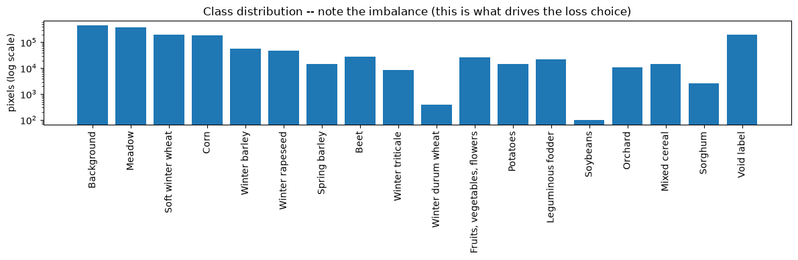

# Satellite Images Time Series Segmentation with V-JEPA 2.1

> Baseline de référence : U-TAE (mIoU 0.631).
> La Méthode 1 (TimeSFormer) est documentée séparément par mon binôme. Ce dépôt présente ma contribution : la Méthode 2.

We implements a native 3D video encoding approach to multi-spectral crop segmentation using V-JEPA 2.1 as backbone. Instead of relying on traditional 2D spatial + 1D temporal recurrent networks, we treat Satellite Image Time Series (SITS) natively as video tensors, trying to adapt a massive pre-trained ViT for Earth Observation data.

## 1. Context

The objective is to perform semantic segmentation of crop parcels (20 classes) across irregular time series of satellite images. The challenge lies in adapting a foundational model trained on standard RGB video to 10-band multi-spectral data, handling extreme class imbalance and managing the high memory overhead of training large Vision Transformers (ViTs) in a Distributed Data Parallel (DDP) environment.

## 2. PASTIS Dataset

The model ingests sequences of satellite patches capturing the phenological development of crops over a year.

* **Inputs:** 10 spectral bands (Visible, NIR, SWIR).
* **Dimensions:** 128x128 pixels at 10m/pixel resolution.
* **Temporal Sequence:** Up to 60 irregular acquisitions per patch.

Below is a time-series representation of a sample patch in the visible RGB spectrum:

<center>

</center>

## 3. Architecture

We are allining tricks and technical choises to try to bridge the gap between Meta's V-JEPA and SITS data constraints.

### A. Spectral Adaptation (`custom_build.py`)

V-JEPA's `patch_embed` natively expects 3-channel RGB input. We dynamically adapt the first 3D convolutional layer to accept 10 channels. To leverage pre-trained weights without destroying them:

* The first 3 channels are warm-started with the original V-JEPA RGB weights.
* The remaining 7 channels (NIR, SWIR) are initialized using `kaiming_normal_` in fan_in mode.

### B. Memory-Safe DDP Loading (`train_head.py`)

Loading a huge ViT-Large/Giant model directly onto all GPUs simultaneously causes out-of-memory (OOM) crashes. We implemented a caching strategy:

1. **Rank 0 Cache:** Only Rank 0 downloads the massive `state_dict` to a shared disk cache.
2. **Barrier Sync:** All ranks hit a `dist.barrier()` to ensure the file is ready.
3. **Lazy Initialization:** Every rank instantiates the model with `pretrained=False`, then loads the cached `state_dict` directly to its respective device mapping.
4. **Key Stripping:** Because the `patch_embed` was modified (10 channels), strict loading would fail. We dynamically strip `patch_embed` keys from the dictionary before calling `load_state_dict(strict=False)`.

### C. Native 3D Encoding & Temporal Masking

The input tensors `(B, T, C, H, W)` are permuted to `(B, C, T, H, W)` to natively act as video inputs. Because satellite acquisitions are irregular and padded, the code introduces a `TemporalMeanPool` module:

* It maps the frame-level mask `(B, T)` to a **temporal-patch-level mask** `(B, T_p)`.
* A temporal patch is only flagged as invalid if *all* its constituent frames are padded/cloudy.
* Valid tokens are then mean-pooled across the temporal dimension to yield a flat spatial grid `(B, H_p * W_p, D)` before passing to the `SegHead`.

### D. LoRA

As it was absolutly out of scope to fine tune the entier V-JEPA 2.1 backbone (model & data size), we use Low-Rank Adaptation.

* We inject LoRA into the `qkv` (attention) and `proj` (output) modules.
* Rank $r=16$, $\alpha=8.0$.

### E. Handling Class Imbalance

The `label_counts` heavily skew towards "Background", "Meadow" and "Winter Wheat". `_compute_class_weights` performs a one-time scan of the dataset (executed by Rank 0 and cached) to generate inverse-frequency weights for the `CrossEntropyLoss`.
<center>

</center>

## 4. Experiment Orchestration

The project uses a nested dictionary generation approach to manage hyperparameter searches without code duplication.

* **Base Config (`config.yaml`):** Defines the backbone (`vjepa2_1_vit_large_384`), learning rate, max epochs and other standard hyperparameters.
* **Combinatorics (`experiment.py` & `experiments.yaml`):** Parses groups of experiments (e.g., `cloud_ablation`, `dataset_scaling`).
* **Torchrun Execution (`train.py`):** Serves as the DDP entry point, spinning up the environment, mapping processes to GPUs and looping through the resolved experiments from the YAML spec.

## 5. Deployment & Execution (Windows Batch)

### Environment Setup

Run the following commands to pull the baseline framework, branches and dependencies:

```cmd
if exist "SITS-Classification" (
    cd SITS-Classification
    git pull
) else (
    git clone https://{token}@[github.com/ELumya/SITS-Classification.git](https://github.com/ELumya/SITS-Classification.git)
    cd SITS-Classification
)

cd V_JEPA
if exist "vjepa2" (
    cd vjepa2
    git pull
    cd ..
) else (
    git clone [https://github.com/facebookresearch/vjepa2.git](https://github.com/facebookresearch/vjepa2.git)
)
cd ..
```

### Model Training Execution

To launch the training cluster using Torch distributed, configure your environment variables and execute:

```cmd
set NPROC=2
set PORT=29500
set CONFIG=\kaggle\working\SITS-Classification\V_JEPA\config.yaml
set EXPERIMENTS=\kaggle\working\SITS-Classification\V_JEPA\experiments.yaml

python -m torch.distributed.run ^
    --standalone ^
    --nproc_per_node=%NPROC% ^
    --master_port=%PORT% ^
    .\V_JEPA\train.py ^
    --config "%CONFIG%" ^
    --experiments "%EXPERIMENTS%"
```

## 6. Results & Aggregation

Evaluation is run out-of-core (`evaluate.py`) to free up VRAM. DDP `all_reduce` is used to aggregate the global confusion matrix across all GPU ranks.

Performance highlights:

* **Best score - Full 10-Band LoRA:** Achieved **0.296 mIoU** with a 0.42 Macro F1.
* **RGB Baseline:** Dropping the non-visible bands reduced performance to 0.273 mIoU.
* **Frozen Weights vs. LoRA:** Freezing the encoder completely caused performance to plummet (0.037 mIoU), proving that indirect spectral adaptation via attention-head fine-tuning (LoRA) is strictly necessary for this domain shift.
